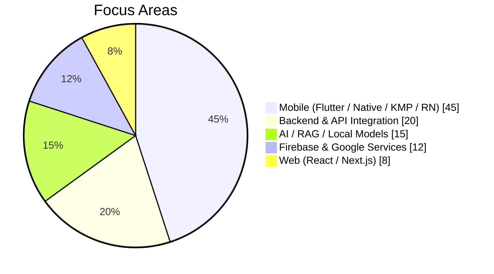
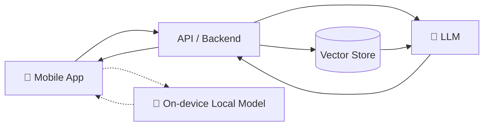
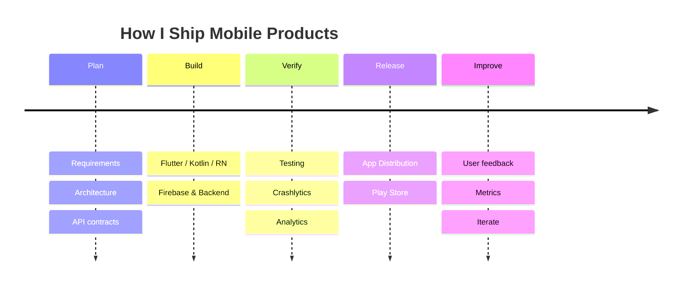

<!-- ============================================================
  REPLACE `YOUR_GITHUB_USERNAME` (appears in the stats/graph URLs)
  with your actual GitHub username before pushing.
============================================================= -->

 

---

### Quick Navigation

<a href="#about-me">About</a> •
<a href="#tech-stack">Tech Stack</a> •
<a href="#expertise-at-a-glance">Expertise</a> •
<a href="#what-i-build">What I Build</a> •
<a href="#ai--intelligent-systems">AI</a> •
<a href="#github-analytics">Analytics</a> •
<a href="#engineering-workflow">Workflow</a> •
<a href="#experience">Experience</a> •
<a href="#lets-connect">Contact</a>

---

## About Me

I'm a **Mobile Application Engineer** and **Deputy Manager** in the **MIS-IT Department at Sapphire Textiles Limited**, with **5+ years** of hands-on experience designing, building and shipping production-grade mobile applications and the backend services that power them.

- 📱 Cross-platform and native mobile development: **Flutter, Kotlin, Java, Jetpack Compose, Kotlin Multiplatform, React Native**
- 🌐 Backend and web integrations with **Node.js, Python/Django, PostgreSQL, React and Next.js**
- 🔥 Deep experience with the **Firebase** and **Google** ecosystems
- 🤖 Building **AI-powered products**: RAG systems, on-device/local models and SaaS platforms
- 🏭 Driving digital transformation through enterprise apps and internal systems in the textile industry

> *"Great software isn't just written, it's engineered, tested, measured and continuously improved."*

[⬆ Back to top](#)

---

## Tech Stack

### Mobile Development

### Backend and Web

### Cloud, Firebase and Google Services

### Quick Icon View

[⬆ Back to top](#)

---

## Expertise at a Glance

> The charts below are an approximate visual summary of where my time and strengths sit.

| Skill | Proficiency |
|:--|:--|
| Flutter / Dart |  |
| Kotlin / Jetpack Compose |  |
| Firebase Suite |  |
| Kotlin Multiplatform |  |
| React Native |  |
| Node.js / Python / Django |  |
| React / Next.js |  |
| AI / RAG Systems |  |

[⬆ Back to top](#)

---

## What I Build

<table>
<tr>
<td width="50%" valign="top">

### 📱 Mobile Applications
- Cross-platform apps with **Flutter** and **React Native**
- Native Android with **Kotlin, Java and Jetpack Compose**
- Shared business logic via **Kotlin Multiplatform**
- Clean architecture, MVVM / MVI, state management
- Play Store publishing and release pipelines

</td>
<td width="50%" valign="top">

### 🔥 Firebase and Google Services
- **Crashlytics** and **Analytics** for stability and insight
- **App Distribution** for QA and staged rollouts
- **Push Notifications** (FCM)
- **Firestore**, **Realtime Database** and **Cloud DB**
- **Real-time chat** systems
- **Google Maps**, **Location services** and **app publishing**

</td>
</tr>
<tr>
<td width="50%" valign="top">

### ⚙️ Backend and Integrations
- REST APIs with **Node.js** and **Django**
- Relational data modelling with **PostgreSQL**
- Secure integration of enterprise systems with mobile clients
- Web dashboards using **React** and **Next.js**

</td>
<td width="50%" valign="top">

### 🧩 SaaS Products
- 🏥 Healthcare
- 💰 Finance
- 🏋️ Fitness
- 💆 Personal care
- …and many more domains

</td>
</tr>
</table>

[⬆ Back to top](#)

---

## AI and Intelligent Systems

I bring AI into mobile and SaaS products in practical, production-minded ways:

- **RAG (Retrieval-Augmented Generation)** pipelines integrated into mobile applications
- **Local / on-device model integration** for privacy-friendly and offline-capable features
- **AI-driven SaaS products** across healthcare, finance, fitness and personal care

[⬆ Back to top](#)

---

## GitHub Analytics

### Contribution Activity

### Achievements

[⬆ Back to top](#)

---

## Engineering Workflow

[⬆ Back to top](#)

---

## Experience

| Period | Role | Organization |
|:--|:--|:--|
| **Aug 2026 – Present** | Deputy Manager, MIS-IT / Mobile Application Engineer | **Sapphire Textiles Limited** |
| **5+ years total** | Mobile Application Engineer (Flutter, Native Android, KMP, React Native) and Full-Stack Developer | Product, SaaS and enterprise projects |

[⬆ Back to top](#)

---

## Let's Connect

I'm always open to discussing mobile engineering, AI-powered products, and interesting collaborations.

<table>
<tr>
<td align="center"></td>
<td align="center"></td>
<td align="center"></td>
</tr>
</table>

 

